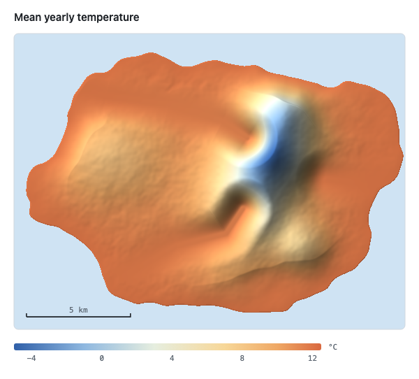
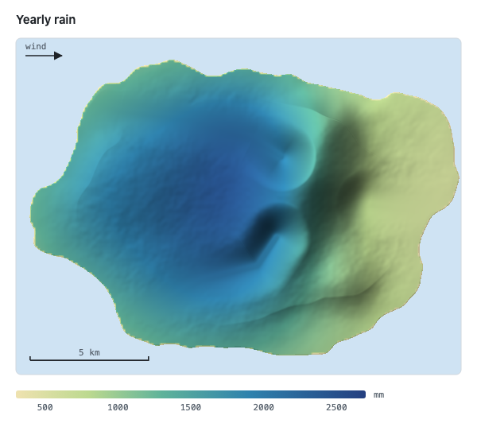
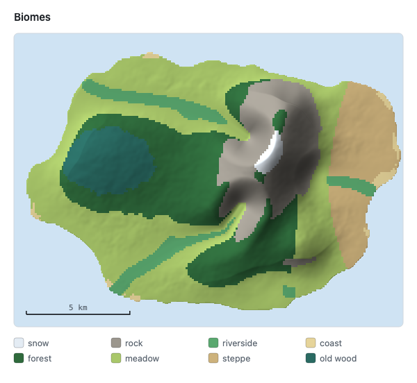
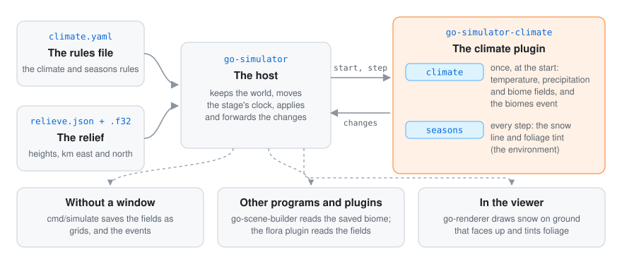

<div align="center">

# Go climate simulator

**The climate and the biomes of a relief, as a plugin for [go-simulator](https://github.com/akrck02/go-simulator).**
Temperature falls with height, moist wind drops its rain on the slopes it climbs and leaves a rain
shadow behind, and biome rules over temperature, rain, slope, rivers and coast give every place its
biome. A `seasons` rule turns the year: snow line and foliage colour.

[](go.mod)


</div>

## 🤖 AI disclosure

I write most of my code by hand, so I want to be clear about this project: **it was written by an
AI assistant (Claude, by Anthropic) under my direction.** I decided what to build and how it should
behave; the code, the tests and the documentation were written by the AI. Every commit made this
way carries a `Co-Authored-By: Claude` line (all of them).

**Status: pending thorough review.** The code compiles and its tests pass, but I have not yet
reviewed it line by line. Treat it as a working draft, not as code I vouch for.

---

<p align="center">
<picture>
  <source media="(prefers-color-scheme: dark)" srcset="docs/images/hero-dark.png">
  
</picture>
</p>

<p align="center"><sub>A made-up island in winter, in go-simulator's viewer: the biomes this plugin chose, and the snow of the season.</sub></p>

## ✨ What it looks like

<table>
<tr>
<th width="33%">Temperature</th>
<th width="33%">Rain</th>
<th width="33%">Biomes</th>
</tr>
<tr>
<td>
<picture>
  <source media="(prefers-color-scheme: dark)" srcset="docs/images/temperature-dark.png">
  
</picture>
</td>
<td>
<picture>
  <source media="(prefers-color-scheme: dark)" srcset="docs/images/rain-dark.png">
  
</picture>
</td>
<td>
<picture>
  <source media="(prefers-color-scheme: dark)" srcset="docs/images/biomes-dark.png">
  
</picture>
</td>
</tr>
<tr>
<td>Colder as you climb: 6.5 °C less every kilometre.</td>
<td>Wet where the wind climbs, dry in the rain shadow behind the ridge.</td>
<td>The first rule of a table that holds, then the world's own regions.</td>
</tr>
<tr>
<td colspan="3" align="center">Worked out once, at the start, from nothing but the relief, so the answers agree with each other and with the land.</td>
</tr>
</table>

## 🚀 Quick start

Clone [go-simulator](https://github.com/akrck02/go-simulator), go-renderer and
[go-scene-builder](https://github.com/akrck02/go-scene-builder) next to this repository. In a rules
file, the climate of a relief is one rule:

```yaml
- rule: climate
  with:
    relief: relieve.json
    origin: [6, 4.5]
    temperature: {sea_level: 12, lapse: 6.5}
    rain: {wind_from: 270, background: 800, orographic: 1800}
    biomes:
      - {biome: snow, when: {temperature: {max: -2.5}}}
      - {biome: forest, when: {precipitation: {min: 1000}}}
      - {biome: steppe}
```

Run the rules file without a window and go-simulator saves the fields as grids:

```bash
cd ../go-simulator && go run ./cmd/simulate -rules climate.yaml -output results
```

[More on getting started →](docs/getting-started.md)

## 🔍 How it works

<p align="center">
  
</p>

go-simulator keeps the world and moves the clock. The `climate` rule works the climate out once, at
the start, and publishes it as fields of the world; the `seasons` rule answers every step with the
season's snow line and foliage tint. The plugin never touches the renderer.
[More on how it works →](docs/how-it-works.md)

## 📚 Documentation

| | |
|---|---|
| [Getting started](docs/getting-started.md) | The folders it needs, a whole rules file, running it without a window and in the viewer, the tests. |
| [The climate model](docs/model.md) | How temperature, rain, river valleys, coasts, biomes, regions and seasons are worked out, with pictures. |
| [How it works](docs/how-it-works.md) | How the plugin fits go-simulator, what happens at the start and every step, and how the pictures were made. |
| [Rules reference](docs/rules.md) | The `climate` and `seasons` rules and every parameter, generated from the plugin's own description. |
