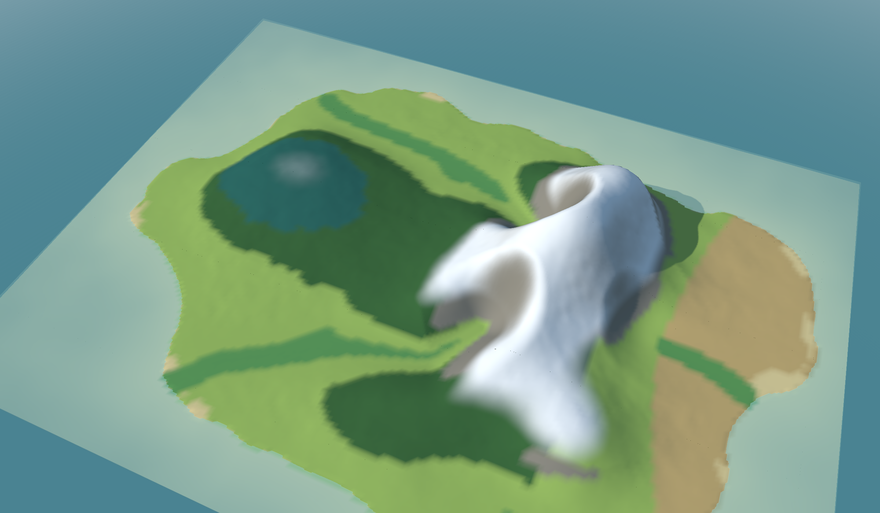

# Welcome to go-simulator-climate 👋

**The climate plugin gives a simulated world its weather**: how warm, how wet, where it snows, and which landscape (*biome*) each place has: forest, meadow, steppe, rock.

From the height of the ground and the wind it works out temperature and rain, then sorts every place into a biome by rules you write. A second rule turns the year: snow comes down in winter and leaves turn in autumn.

## Is it for me?

- ✅ You use [go-simulator](https://github.com/akrck02/go-simulator) and want **weather and biomes**.
- ✅ You want to **set it up by writing a rules file**: no programming needed.
- ✅ You are curious about **the science** behind it: the pages explain the model with pictures.

## Where to start

Pick the line that sounds like you.

| If you… | Read | Time |
|---|---|---|
| are **new** and want to see it work | 🏴‍☠️ [The quest](2-the-quest.md): an island's weather and biomes, in 5 levels | 45 min |
| want to **run its example** | [Getting started](3-getting-started.md) | 10 min |
| want to know **how the climate is worked out** | [The model](4-the-model.md) | 15 min |
| are **looking up** a parameter | [Rules reference](6-rules-reference.md) | — |

## All the pages, in reading order

The menu on the left (or the files in `docs/`) follows this order.

**Start**

- [Overview](1-overview.md): this page
- [The quest](2-the-quest.md)
- [Getting started](3-getting-started.md)

**Understand**

- [The model](4-the-model.md)
- [How it works](5-how-it-works.md)

**Reference**

- [Rules reference](6-rules-reference.md)

## 🚧 Not done yet

- The climate does not change with time on its own: the `climate` rule works it out once (and
  again only when the world's ground changes, as the terrain's `erosion` rule makes it), and the
  `seasons` rule moves only the snow line and the foliage tint, not the `temperature` and
  `precipitation` fields. There is no weather yet (no single storms, no daily rain).
- The foliage tint is drawn only on materials marked as foliage; the made-up island in these pages
  has no vegetation, so its pictures show the snow but not the tint.
- The only example rules file, `examples/mountain.yaml`, works out the climate of a synthetic
  mountain without the seasons; the pages show the rest as rules to copy.

## Words you will meet

| Word | What it means |
|---|---|
| Terminal | The window where you type commands: *Terminal* on macOS and Linux, *PowerShell* on Windows. |
| Repository | A project's folder of files, kept on GitHub. `git clone <address>` copies it to your computer. |
| Plugin | A small program that adds one ability to another: here, one kind of simulation each. |
| Rules file | A text file (YAML) that says which plugins to use, with which numbers, for how long: no programming needed. |
| Field | A grid of numbers laid over the world: the height of every spot, its temperature, its rain. |
| Quest | The tutorial of these docs: short levels, each ending with something that works and an achievement. |

## The family

go-simulator-climate is one of a family of small projects that work together:

| Project | What it does |
|---|---|
| [go-renderer](https://github.com/akrck02/go-renderer) | draws 3D scenes and flat interfaces |
| [go-ui](https://github.com/akrck02/go-ui) | buttons, panels and whole applications |
| [go-ui-android](https://github.com/akrck02/go-ui-android) | Android apps that look like Android's own |
| [go-sound](https://github.com/akrck02/go-sound) | sound and music |
| [go-scene-builder](https://github.com/akrck02/go-scene-builder) | 3D scenes from a flat map |
| [go-simulator](https://github.com/akrck02/go-simulator) | simulations that change a scene |
| [go-simulator-terrain](https://github.com/akrck02/go-simulator-terrain) | ground shaped by rivers |
| **go-simulator-climate** (this one) | weather and biomes |
| [go-simulator-flora](https://github.com/akrck02/go-simulator-flora) | forests that grow |
| [go-simulator-urban](https://github.com/akrck02/go-simulator-urban) | towns that grow |
| [go-simulator-motion](https://github.com/akrck02/go-simulator-motion) | a scene that moves |
| [go-3ds](https://github.com/akrck02/go-3ds) | Go on the Nintendo 3DS |

> ⚠️ All of them are **educational experiments**, written with an AI assistant and pending review by their author: good for learning and playing, not for production.
