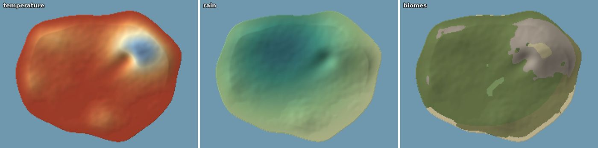
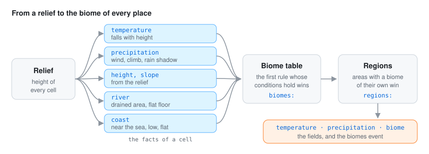
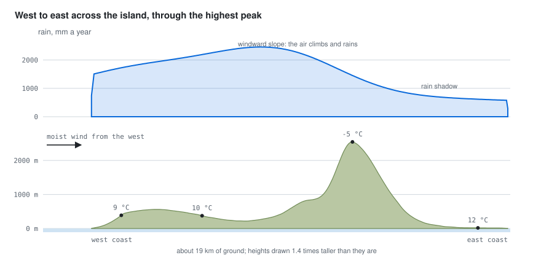
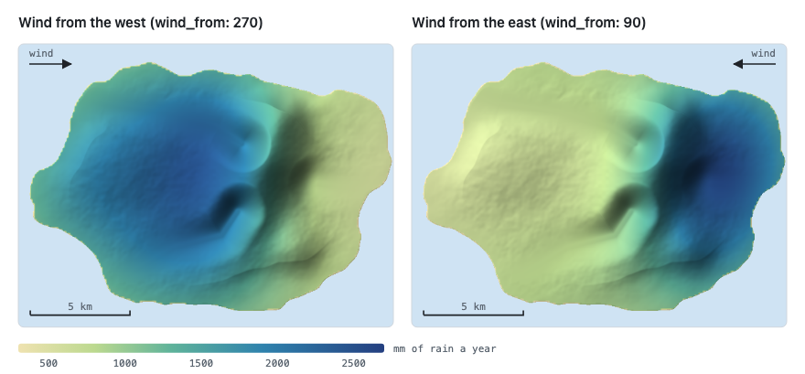
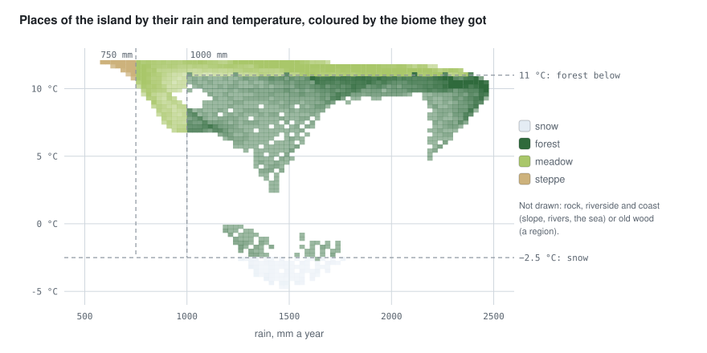
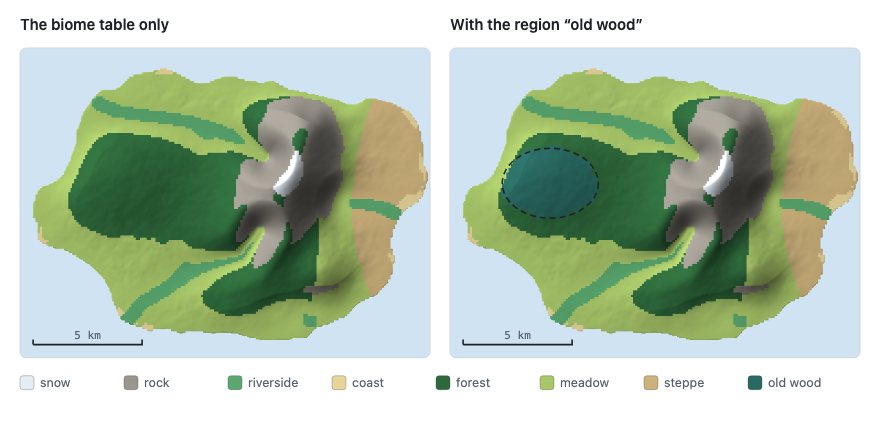
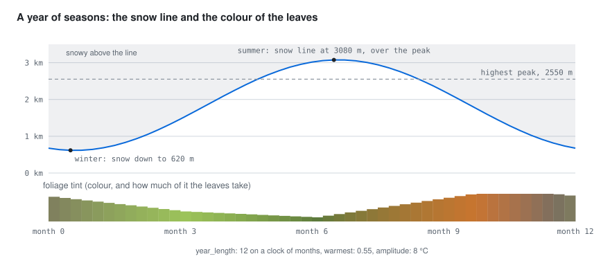

# 🌦️ The climate model

Where is it cold? Where does it rain? What grows there? The climate plugin answers these three
questions for every place of a map, starting only from its relief, so that the answers always agree
with each other and with the land: no snow at the beach, no rainforest in a rain shadow.



*Colder on the mountain, wetter on the slope that faces the wind, and the biomes that follow.*

<p align="center">
  
</p>

It works the climate out at the start and publishes three fields and an event:

| Output | Content |
|---|---|
| field `temperature` | mean yearly temperature, °C |
| field `precipitation` | yearly rain and snow, mm |
| field `biome` | index into the names of the `biomes` event, −1 for the sea |
| event `biomes` | `{"names": […]}`, the biome of every index |

The grid has the cell given by `cell` (km), over the relief's extent; `origin` places the relief's
kilometres east and north on the world (`x = east − origin[0]`, `z = origin[1] − north`).

The relief is the `relief` file or, without one, the world's `elevation`, as the
[terrain plugin](https://github.com/akrck02/go-simulator-terrain) publishes it (put it first). On
the world's ground the climate also takes the world's `drainage_area` when there is one (see
below), and when that ground changes, because the terrain's `erosion` rule moved it, the climate is
worked out again in the step after and published again.

The maps and charts below are of a made-up island, 20 km by 15 km, with a ridge of about 2,550
metres in the east, run with the rules file in [getting started](3-getting-started.md#a-rules-file).

## Temperature

Air gets colder as you climb, by about 6.5 °C every kilometre. That is most of the story:

```
temperature = sea_level − lapse × height_km + northward × (north − middle of the map) / 10
```

`sea_level` is the mean at sea level (°C), `lapse` the degrees lost per kilometre of height (6.5 is
the standard atmosphere) and `northward` an optional gradient per 10 km (negative: colder to the
north). Sea cells take the sea-level value.

<p align="center">
<picture>
  <source media="(prefers-color-scheme: dark)" srcset="images/temperature-dark.png">
  
</picture>
</p>

With `sea_level: 12` and `lapse: 6.5`, the coast is at 12 °C and the top of the ridge, about 2.5 km
up, at about −4.5 °C.

## Rain

Rain is the interesting part. Moist air blows in from one side; when it has to climb a mountain it
cools and drops its water on the slope facing the wind, and by the time it comes down the other
side it is dry: the rain shadow. The plugin follows that air across the map. A semi-Lagrangian
moisture model carries it from where the wind comes
(`wind_from`, degrees clockwise from north):

1. The relief the air feels is smoothed (`relief_scale`, km), and the moisture is carried on a
   coarser grid (`calculation_cell`, km), downwind, cell by cell: every cell takes the air of the
   cell upwind.
2. Over land the air drops a share of its moisture every cell (`base`), more where it climbs
   (`rise`, extra share per metre up per metre forward): orographic rain on the windward slopes.
3. Over the sea it recovers a share of what it misses (`recharge`); over flat land, slowly
   (`evaporation`). Behind a ridge, the air is drier: the rain shadow.
4. The rain of a place is `background` mm a year times the air's humidity there (1 = saturated:
   frontal rain) plus `orographic` mm times what the air dropped there, measured against the most
   exposed 3 % of the land. Both are smoothed by `smoothing` km.

Without `rain` settings the defaults are neutral, for every world to set its own: the wind from
the west, as the westerlies of the middle latitudes blow; 1,000 mm of `background`, about the
world's mean (2.6 mm a day; Adler et al. 2003, the GPCP analysis); and 1,000 mm of `orographic`,
which doubles the rain on the most exposed windward slopes, a moderate case of what mountain
ranges show (Roe 2005).

<p align="center">
  
</p>

The same island with the wind turned round: everything else is the same, so the wet side and the
rain shadow swap places.

<p align="center">
<picture>
  <source media="(prefers-color-scheme: dark)" srcset="images/wind-dark.png">
  
</picture>
</p>

## River valleys and coasts

The area that drains through every land cell is followed downhill, from the highest cell to the
lowest: each cell sends its water to the lowest of its eight neighbours. When the world has a
`drainage_area` (the terrain's `erosion` rule publishes it, with hollows filled so all water
reaches the sea), that one is used instead, so the climate's rivers are the terrain's: every cell
of the climate's grid takes the largest area of the cells inside it, so a river one fine cell wide
is not lost on a coarser grid. A cell is on a **river valley** when it drains more than `river_area` km²
and is flatter than `river_slope`; the valley floor is widened by two cells. A cell is on the
**coast** when it is within `coast_reach` km of the sea, lower than `coast_low` metres and flatter
than `coast_slope`.

On the [biome map](#biomes) below, `riverside` follows the island's three valleys down to the sea,
and `coast` is the thin low rim where the land meets it.

## Biomes

With heat and rain known, choosing the biome is a matter of rules, like a field guide: "colder
than −2.5 °C: snow; steeper than 0.6: rock; otherwise, if it rains more than 1000 mm: forest…".
Every land cell gets the first biome whose conditions hold, in the order written:

```yaml
biomes:
  - {biome: snow, when: {temperature: {max: -2.5}}}
  - {biome: rock, when: {slope: {min: 0.6}}}
  - {biome: riverside, when: {river: true}}
  - {biome: coast, when: {coast: true}}
  - {biome: forest, when: {temperature: {max: 11}, precipitation: {min: 1000}}}
  - {biome: steppe}                       # no conditions: everything left
```

Conditions use go-simulator's [condition language](https://github.com/akrck02/go-simulator/blob/main/docs/5-reference/1-vocabulary-and-conditions.md#conditions)
over the facts of a cell: `temperature`, `precipitation` (mm), `height` (m), `slope` (rise over
run), `river_area` (km² drained), and the yes/no facts `river` and `coast`. An unknown fact is an
error.

<p align="center">
<picture>
  <source media="(prefers-color-scheme: dark)" srcset="images/biomes-dark.png">
  
</picture>
</p>

The island's table is the one above with a `meadow` rule (`precipitation: {min: 750}`) before
`steppe`. Placing every place by its rain and temperature shows the table at work: each biome fills
the box its conditions leave it.

<p align="center">
  
</p>

## Regions

Regions give areas of the map a biome of their own, over the table: an `ellipse` (`centre` and
`radii`, km east and north) or a `polygon`, with their own conditions. `ragged` (a share of the
ellipse's size) makes the edge irregular, like a real forest's, with smooth value noise that is the
same for the same place.

```yaml
regions:
  - {biome: old wood, ellipse: {centre: [3, 6], radii: [2, 1.5]}, ragged: 0.15, when: {height: {min: 150}}}
```

<p align="center">
<picture>
  <source media="(prefers-color-scheme: dark)" srcset="images/regions-dark.png">
  
</picture>
</p>

## Seasons

The yearly mean is not the whole story when you watch a scene: snow comes down in winter and
leaves turn in autumn. The `seasons` rule turns the year on any clock: the year lasts `year_length` units of the stage's
time (months on a stepped clock, seconds on a real-time one), and `warmest` says when in the year
it is warmest (a share: 0.35 is a little past a third). The temperature swings `amplitude` °C
around the yearly mean, so the snow line, where the season's temperature falls below `snow_at`,
climbs in summer and comes down in winter (with `snow_blend` metres of fade). Foliage takes the
colour of the season from `foliage` stops (`{at, color, amount}`), interpolated around the year.

It changes the environment (`snow` and `foliage_tint`); go-renderer draws snow on surfaces that
face up and tints materials marked as foliage.

<p align="center">
  
</p>

<table>
<tr>
<th width="50%">Winter</th>
<th width="50%">Summer</th>
</tr>
<tr>
<td></td>
<td></td>
</tr>
</table>

The `snow` biome and the season's snow are two different things: the biome is where the yearly mean
is cold enough (a colour of the terrain, the same all year), the season's snow is drawn on top of
everything above the snow line of the moment.

## Use

```bash
cd ../go-simulator && go run ./cmd/simulate -rules climate.yaml -output results
```

The [flora plugin](https://github.com/akrck02/go-simulator-flora) reads the fields from the world to
grow vegetation.

For [go-scene-builder](https://github.com/akrck02/go-scene-builder), which colours the terrain and sows
each biome's vegetation from a layer (`-layer biome=biomes.json`), give the rule a `layer`:

```yaml
- rule: climate
  with: {relief: relieve.json, origin: [3, 2], layer: biomes.json, …}
```

It saves `biomes.json` and `biomes.f32` once, at the start, next to the rules file (or where the path
says). The grids go-simulator saves in its snapshots will not do for this: their coordinates are the
world's x and z, which move with `origin`, and the names of the biomes are not in them (they travel in
the `biomes` event). The layer is in the relief's own kilometres east and north, like the scene
builder's map and relief, and carries the names as `labels`; the sea is −1, with no name. [Getting started](3-getting-started.md) has a whole rules file
and the way to the viewer.

## References

- Adler, R. F. et al. (2003). The version-2 Global Precipitation Climatology Project (GPCP) monthly
  precipitation analysis (1979–present). *Journal of Hydrometeorology* 4.
- Roe, G. H. (2005). Orographic precipitation. *Annual Review of Earth and Planetary Sciences* 33.
