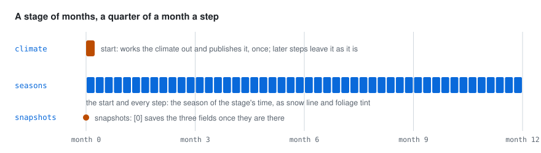

# 🔍 How it works

## How the plugin fits go-simulator

  

go-simulator is the host. It keeps the world (its entities, fields and environment) and moves the
clock. The climate plugin is a separate program the host starts; they talk over standard input and
output (go-simulator's [protocol](https://github.com/akrck02/go-simulator/blob/main/docs/5-reference/2-protocol.md)).

- At the start the plugin **describes** itself: its two rules, their parameters, what each one
  reads and what it writes. That description is also where the [rules reference](6-rules-reference.md) comes
  from.
- `climate` reads nothing from other plugins. It loads the relief named in its parameters and
  writes the fields `temperature`, `precipitation` and `biome`, and the `biomes` event with the
  name of every biome.
- `seasons` reads the environment and writes `environment`: the snow line (`snow`) and the foliage
  tint (`foliage_tint`).

A plugin never touches the renderer: it reads its copy of the world and answers with changes
(go-simulator's [writing plugins](https://github.com/akrck02/go-simulator/blob/main/docs/4-guides/4-writing-plugins.md)).
Fields use physical units and shapes world units, as go-simulator's
[vocabulary](https://github.com/akrck02/go-simulator/blob/main/docs/5-reference/1-vocabulary-and-conditions.md) lists. Other
plugins read the fields from the world instead of working the climate out again.

## What happens at the start and every step

  

- **At the start**, `climate` works the climate out and publishes it. If a stage does not start it,
  the first step does instead. Later steps leave it as it is: the climate does not change with
  time yet.
- **At the start and every step**, `seasons` takes the share of the year the stage's time has
  reached (`time / year_length`, around and around), works out the season's temperature at sea
  level, `sea_level + amplitude × cos(2π × (share − warmest))`, and from it the height of the snow
  line, `(that temperature − snow_at) / lapse` km, never below sea level. The foliage tint is the
  `foliage` stops interpolated at the same share, from the last stop round to the first.

Both work on any clock: a stage of months with `year_length: 12`, or a real-time stage with
`year_length: 240` for a year every four minutes.

## How the pictures were made

The pictures of the made-up island in these pages were drawn from the plugin's own answers. A small
throwaway program, kept outside the repository, wrote a made-up relief (an island 20 km by 15 km,
with a ridge in the east, a hill in the west and three valleys), ran the real plugin inside a
go-simulator host with the rules file in [getting started](3-getting-started.md#a-rules-file), read
back the three fields and the environment after every step of the year, and drew them: the maps,
the cut across the island, the year of seasons and the chart of biomes. The map with the wind from
the east and the one without the region are the same run with `wind_from: 90`, or with no
`regions`. Maps are PNG pictures in a light and a dark version; the charts are SVG with their own
light and dark colours.

The 3D pictures are go-simulator's viewer: the same rules run with `cmd/simulate`, go-scene-builder
built a scene from the relief coloured by the `biome` snapshot, and the viewer captured a frame
(`-capture`) at month 0.25 and month 6.5 (`-advance 1`, `-advance 26`), and at night (`-night`) for
the dark version of the picture at the top of the README. The diagrams (how it fits, the model, the
steps) were drawn by hand in the same style.

The picture of the example island at the top of [the climate model](4-the-model.md) came with the
repository and was kept as it was.
