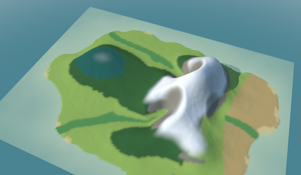
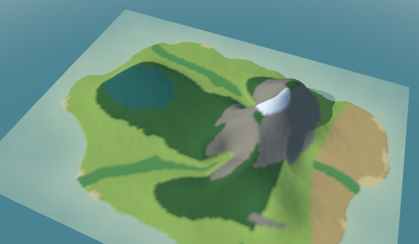

# 🚀 Getting started

## The folders it needs

The plugin is developed next to the projects it uses: `go.mod` replaces go-simulator, go-renderer
and go-scene-builder with the folders beside this one. Clone them side by side:

```
go-renderer/
go-scene-builder/
go-simulator/
go-simulator-climate/   ← this repository
```

## A rules file

The plugin needs one thing from your world: a relief, in go-scene-builder's format
(`relieve.json`, with the heights in `relieve.f32` next to it, in kilometres east and north). The
rest is numbers in a rules file. This one, `climate.yaml` in the `go-simulator` folder, is the one
the pictures in these pages were made with, on a made-up island:

```yaml
plugins:
  - name: climate
    command: [go, run, .]
    directory: ../go-simulator-climate

stages:
  - name: year
    clock: {unit: month, from: 0, to: 12, step: 0.25, pace: 0.5}
    snapshots: [0]
    snapshot_fields: [temperature, precipitation, biome]
    rules:
      - rule: climate
        with:
          relief: relieve.json
          origin: [10, 7.5]
          cell: 0.1
          temperature: {sea_level: 12, lapse: 6.5}
          rain: {wind_from: 270, background: 800, orographic: 1800}
          terrain: {river_area: 5, river_slope: 0.04}
          biomes:
            - {biome: snow, when: {temperature: {max: -2.5}}}
            - {biome: rock, when: {slope: {min: 0.6}}}
            - {biome: riverside, when: {river: true}}
            - {biome: coast, when: {coast: true}}
            - {biome: forest, when: {temperature: {max: 11}, precipitation: {min: 1000}}}
            - {biome: meadow, when: {precipitation: {min: 750}}}
            - {biome: steppe}
          regions:
            - {biome: old wood, ellipse: {centre: [5.2, 8.4], radii: [2.2, 1.6]}, ragged: 0.15, when: {height: {min: 150}}}
      - rule: seasons
        with:
          year_length: 12
          warmest: 0.55
          temperature: {sea_level: 12, lapse: 6.5, amplitude: 8}
          snow_at: 0
          snow_blend: 150
          foliage:
            - {at: 0.25, color: "#9cc35a", amount: 0.15}
            - {at: 0.5, color: "#5d7a3c", amount: 0}
            - {at: 0.8, color: "#c8752f", amount: 0.6}
            - {at: 0.95, color: "#7a6e5f", amount: 0.6}
```

The plugin starts with `go run` from this repository, so it needs no installing. The stage is a
year of months, a quarter of a month a step; `pace` is how many real seconds a step takes in the
viewer. Every key is in go-simulator's
[rules files](https://github.com/akrck02/go-simulator/blob/main/docs/rules-files.md), and every
parameter of the two rules in the [rules reference](rules.md).

## Without a window

```bash
cd ../go-simulator && go run ./cmd/simulate -rules climate.yaml -output results
```

go-simulator runs the year as fast as it can and saves, in `results/`, the three fields as grids
(`year 0 biome.json` with `year 0 biome.f32` next to it, and so on), and every event in
`events.jsonl`, among them the `biomes` event with the name of every biome:

```json
{"data":{"names":["snow","rock","riverside","coast","forest","meadow","steppe","old wood"]},"name":"biomes","origin":"climate","stage":"","time":0}
```

The [flora plugin](https://github.com/akrck02/go-simulator-flora) reads the fields from the world to
grow vegetation. For [go-scene-builder](https://github.com/akrck02/go-scene-builder), which colours
the terrain and sows each biome's vegetation from a layer (`-layer biome=…`), add `layer:
biomes.json` to the climate rule: it saves `biomes.json` and `biomes.f32` next to the rules file,
with the biome names as `labels` and in the relief's kilometres east and north, so the layer lines
up with the relief whatever the `origin` (see [the model](model.md#use)).

## In the viewer

<table>
<tr>
<th width="50%">Month 0: winter</th>
<th width="50%">Month 6.5: summer</th>
</tr>
<tr>
<td></td>
<td></td>
</tr>
<tr>
<td colspan="2" align="center">The same scene, a season apart: the <code>seasons</code> rule moves the snow line, and go-renderer draws snow on the ground that faces up above it.</td>
</tr>
</table>

To see the island in 3D, go-scene-builder builds a scene from the relief, coloured by the biomes,
and go-simulator's viewer shows it while the rules run:

```bash
cd ../go-scene-builder
go run ./cmd/build-scene -map empty.geojson -relief relieve.json -layer biome=biomes.json -style style.yaml -out island.glb
cd ../go-simulator
go run ./cmd/simulator -rules climate.yaml island.glb
go run ./cmd/simulator -rules climate.yaml -advance 26 -capture summer.png island.glb
```

The style gives every biome a colour under `terrain.biomes` (see go-scene-builder's
[decoration](https://github.com/akrck02/go-scene-builder/blob/master/docs/decoration.md#biomes)), and
`empty.geojson` is a map with no features. `-advance 26` steps the year 26 times before showing,
to month 6.5.

`biomes.json` is the layer the climate rule saves with `layer: biomes.json`. The snapshot's
`year 0 biome.json` will not do as it is: it has no names, and its edges are the world's, which
match the relief's only with `origin: [0, 0]`.

## The tests

```bash
go vet ./...
go test ./...
```

The tests build a round island with a ridge running north to south and check that the ridge is as
cold as its height says, that the slope facing the west wind is wetter than the other, that snow,
sea and a region's biome land where they should, and that the seasons move the snow line and the
foliage around the year. Others read the biome layer back with go-scene-builder's own loader, with
an origin away from zero, work the climate out on the world's ground and drainage and again when
that ground rises, and check that every rule describes its contracts.
