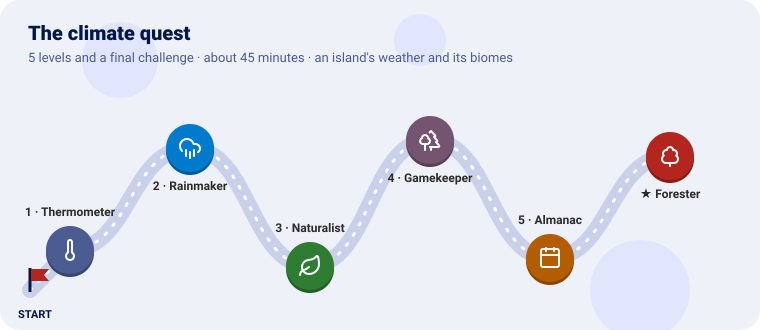
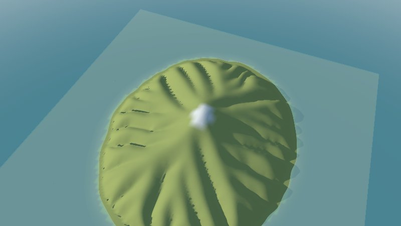
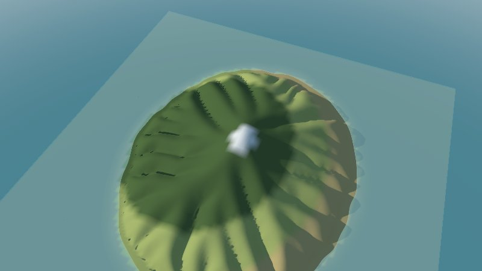
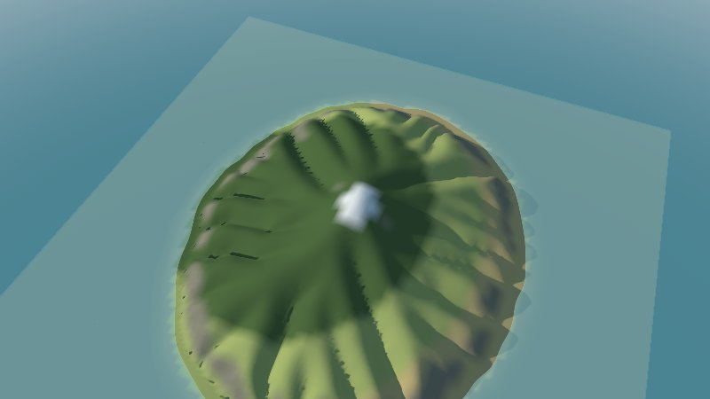
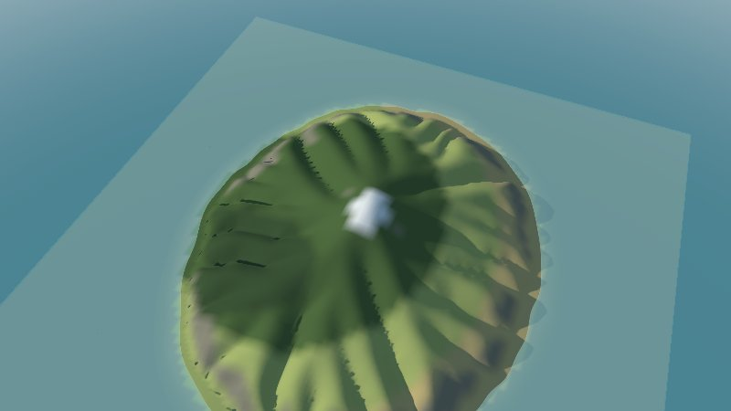
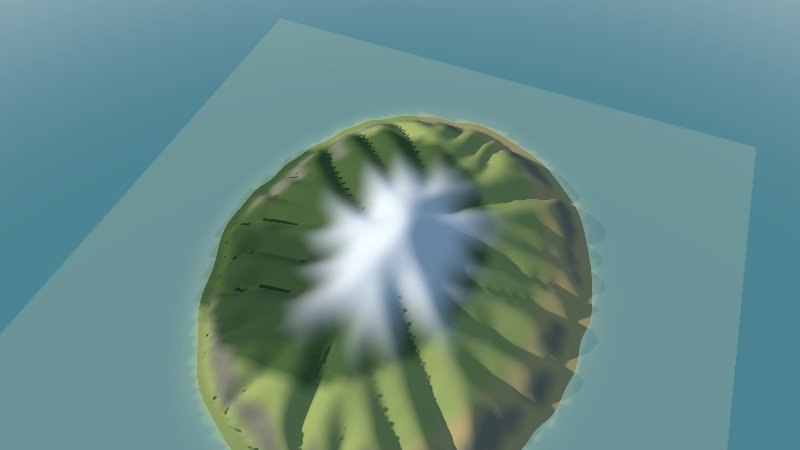
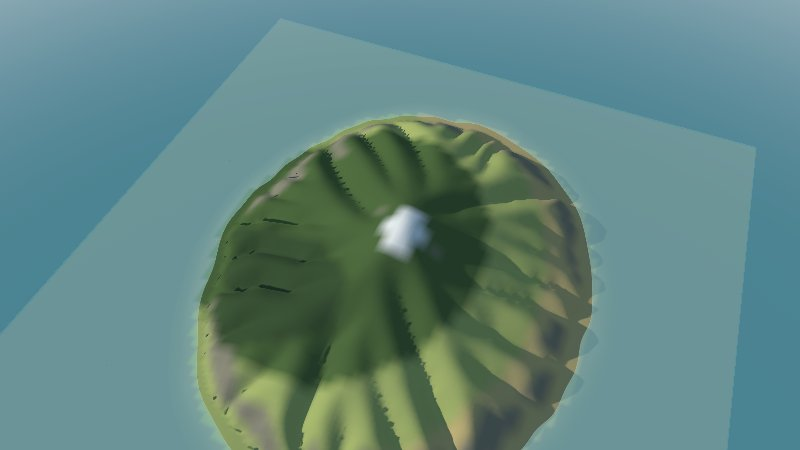
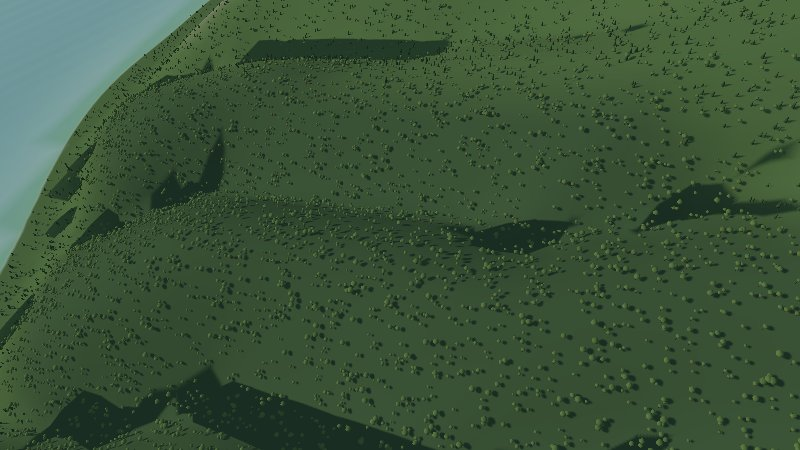
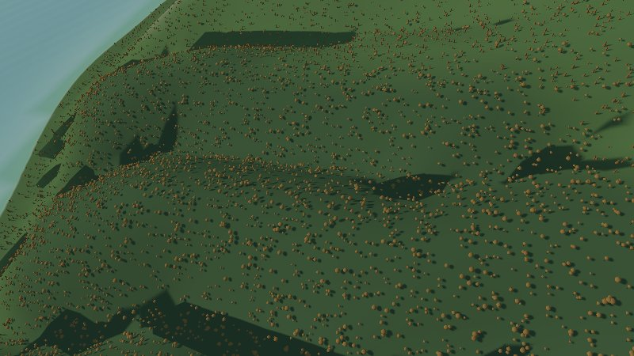
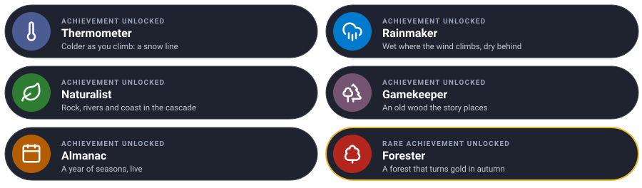

# The climate quest

Give an island its weather, one level at a time. Each level teaches one piece of the climate
plugin and ends with the island coloured by its **biomes**: snow, rock, forest, meadow, steppe.



We use the mountain island shaped in [the terrain quest](https://github.com/akrck02/go-simulator-terrain/blob/main/docs/quest.md)
(any relief will do). It gets cold as it climbs, wet where the west wind meets it and dry behind
it; rivers, cliffs and beaches find their own biomes; an old wood stands where the story puts it;
and a year passes, with snow and autumn colours.

---

Every level has the same shape: **the idea** (explained with something from everyday life), **the
rules**, a **checkpoint** to know it works, and an optional **bonus**.

---

## Before you start

You need Go 1.25 and GEOS (`sudo apt install libgeos-dev`, `brew install geos`). Clone the
projects side by side and make a folder for the quest:

```sh
git clone https://github.com/akrck02/go-renderer
git clone https://github.com/akrck02/go-scene-builder
git clone https://github.com/akrck02/go-simulator
git clone https://github.com/akrck02/go-simulator-climate
mkdir weather && cd weather
```

Put the island's relief in it as `island.json` and `island.f32`: from the terrain quest, the end
snapshot `results/island 200 elevation.json` and `.f32`, renamed. (Or write your own with the
terrain quest's `island/main.go`.)

### Looking at the biomes

The climate rule can save its biomes as a **layer** that go-scene-builder colours the terrain with.
Two small files, made once. `empty.geojson`, a map with nothing on it:

```json
{"type": "FeatureCollection", "properties": {"units": "km"}, "features": []}
```

`view.yaml`, a colour for every biome:

```yaml
units: m
chunk: 2
environment: {sun: [220, 35], water_level: 0}
terrain:
  color: "#8a8674"
  biomes:
    snow: {color: "#eeeeea"}
    rock: {color: "#8a8674"}
    meadow: {color: "#a7b46a"}
    steppe: {color: "#c8b47a"}
    forest: {color: "#4f6b3a"}
    riverside: {color: "#6f9a5a"}
    coast: {color: "#d9cfa3"}
    old wood: {color: "#3b5230"}
```

After every run:

```sh
go run ../go-scene-builder/cmd/build-scene -map empty.geojson -relief island.json -layer biome=biomes.json -style view.yaml -out island.glb
go run ../go-renderer/cmd/visor island.glb
```

The pictures were taken with `-zoom 0.75 -sun-azimuth 250 -sun-elevation 25`.

---

## Level 1 · The Thermometer

| Mission | Pieces | Time |
|---|---|---|
| Colder as you climb, and snow on top | `climate`, `temperature`, biome rules, `layer` | 8 min |

#### The idea

Climb a mountain and your **ears pop and your hands get cold**: the air cools about 6.5 °C for every
kilometre up. That is the **lapse rate**. Start from the temperature at the sea and the height of
every cell says how cold it is.

**Biomes** are a list of rules read top to bottom, like a **sorting hat**: each cell gets the first
biome whose conditions it meets. The last rule, with no conditions, catches everything left.

#### Build it

`rules.yaml`:

```yaml
plugins:
  - name: climate
    command: [go, run, .]
    directory: ../go-simulator-climate

stages:
  - name: year
    clock: {unit: month, from: 0, to: 1, step: 1}
    snapshots: [1]
    snapshot_fields: [temperature, biome]
    rules:
      - rule: climate
        with:
          relief: island.json
          origin: [0, 0]
          layer: biomes.json
          temperature: {sea_level: 12, lapse: 6.5}
          biomes:
            - {biome: snow, when: {temperature: {max: 6}}}
            - {biome: meadow}
```

```sh
go run ../go-simulator/cmd/simulate -rules rules.yaml -output results/
```

#### Checkpoint

`biomes.json` and `biomes.f32` appear next to the rules file, and `results/` holds
`year 1 temperature` and `year 1 biome`. On the island, a cap of snow above about a kilometre, and
meadow everywhere else.



#### Bonus (optional): an ice age

<details>
<summary>🔓 Show the solution</summary>

`temperature: {sea_level: 8, lapse: 6.5}`: four degrees colder at the sea, and the snow comes down
some 600 metres.

</details>


Learn more: [The model](model.md) · [Rules](rules.md#climate)

---

## Level 2 · The Rainmaker

| Mission | Pieces | Time |
|---|---|---|
| Wet where the wind climbs, dry behind | `rain`, precipitation in biome rules | 8 min |

#### The idea

Wind from the sea carries water. When it meets a mountain it **climbs, cools and rains**, like a
**sponge squeezed** on the way up; past the top it comes down dry. So the side facing the wind is
wet and green, and the other side, in its **rain shadow**, is dry.

#### Build it

In the climate rule, a west wind, and biomes by rain (millimetres a year):

```yaml
          rain: {wind_from: 270, background: 450, orographic: 1400}
          biomes:
            - {biome: snow, when: {temperature: {max: 6}}}
            - {biome: forest, when: {precipitation: {min: 1500}}}
            - {biome: meadow, when: {precipitation: {min: 1250}}}
            - {biome: steppe}
```

`wind_from: 270` is a wind from the west; `orographic` is how much more rain the climb brings.
Add `precipitation` to `snapshot_fields` to see the rain itself.

#### Checkpoint

A ring of dark forest on the high, wet slopes; meadow below; and the east side, behind the
mountain, turns to tan steppe.



#### Bonus (optional): an east wind

<details>
<summary>🔓 Show the solution</summary>

`wind_from: 90`: the forest and the steppe swap sides.

</details>


---

## Level 3 · The Naturalist

| Mission | Pieces | Time |
|---|---|---|
| Cliffs, riverbanks and beaches | `slope`, `river`, `coast`, `terrain` | 6 min |

#### The idea

A **naturalist** knows that what grows depends on more than weather: nothing roots on a **cliff**,
willows line the **rivers**, and the **shore** has its own plants. The plugin works out the slope,
where water gathers into rivers and where the coast is, and the biome rules can ask for them.

Order matters: the sorting hat takes the **first** rule that fits, so the special places come
before the weather.

#### Build it

```yaml
          terrain: {river_area: 0.5, river_slope: 0.05}
          biomes:
            - {biome: snow, when: {temperature: {max: 6}}}
            - {biome: rock, when: {slope: {min: 0.6}}}
            - {biome: riverside, when: {river: true}}
            - {biome: coast, when: {coast: true}}
            - {biome: forest, when: {precipitation: {min: 1500}}}
            - {biome: meadow, when: {precipitation: {min: 1250}}}
            - {biome: steppe}
```

#### Checkpoint

Grey rock on the steepest cliffs of the coast, pale sand along the shore, and greener strips where
the rivers run.




---

## Level 4 · The Gamekeeper

| Mission | Pieces | Time |
|---|---|---|
| An old wood that the story puts there | `regions` | 5 min |

#### The idea

Some places are not where the weather says, but where **the story** says: a royal hunting forest,
an old wood with a name. A **region** is a **stencil** laid on the map: inside it, a biome of its
own, where its conditions hold. `ragged` frays its edge so it does not look drawn with a compass.

#### Build it

After `biomes`, in the climate rule (the centre is in kilometres east and north):

```yaml
          regions:
            - {biome: old wood, ellipse: {centre: [-1.5, -1], radii: [1.2, 0.8]}, ragged: 0.15, when: {height: {min: 100}}}
```

#### Checkpoint

A darker patch of old wood in the south-west, its edge frayed, never on the beach (it asks for
100 m at least). The `biomes` event in `results/events.jsonl` lists it among the names.




---

## Level 5 · The Almanac

| Mission | Pieces | Time |
|---|---|---|
| A year of seasons, live in the viewer | `seasons`, a month clock, the live simulator | 8 min |

#### The idea

An **almanac** tells what each month brings. The `seasons` rule moves the **snow line** down in
winter and up in summer, and tints the leaves through the year: fresh green in spring, dark in
summer, orange in autumn. The renderer draws it on the scene as it runs.

#### Build it

A year of months, a quarter of a month every half second, and the seasons after the climate:

```yaml
    clock: {unit: month, from: 0, to: 12, step: 0.25, pace: 0.5}
    snapshots: [0]
    rules:
      - rule: climate
        with: { … as before … }
      - rule: seasons
        with:
          year_length: 12
          warmest: 0.55
          temperature: {sea_level: 12, lapse: 6.5, amplitude: 8}
          snow_at: 0
          snow_blend: 150
          foliage:
            - {at: 0.25, color: "#9cc35a", amount: 0.15}
            - {at: 0.5, color: "#5d7a3c", amount: 0}
            - {at: 0.8, color: "#c8752f", amount: 0.6}
            - {at: 0.95, color: "#7a6e5f", amount: 0.6}
```

Build the scene as before, then run it **live**:

```sh
go run ../go-simulator/cmd/simulator -rules rules.yaml island.glb
```

#### Checkpoint

The year turns: in winter, snow down the mountain's shoulders; by summer, only the snow biome on
the peak. `-advance 26` starts in summer.





#### Bonus (optional): a harsher winter

<details>
<summary>🔓 Show the solution</summary>

`amplitude: 12`: winters colder and summers hotter; the snow line swings further.

</details>


---

## Final challenge · Forester

Fill the forest with **trees**: firs and oaks in the forest, oaks in the old wood and along the
rivers, and watch them turn **orange in autumn**.

> **Hint:** go-scene-builder sows models over a biome: `terrain.biomes.<name>.decorate` with the
> `scatter` recipe, and a model library. A part with `material: {foliage: true}` takes the
> seasons' tint.

Try it on your own first, then compare with the solution.





<details>
<summary>🔓 Show the solution</summary>

`models.yaml`:

<pre><code>models:
  fir:
    variants: 3
    vary: {color: 0.1, scale: [0.8, 1.3]}
    parts:
      - {shape: cylinder, radius: 0.3, height: 2, color: &quot;#5a4632&quot;}
      - {shape: cone, radius: 2.2, height: 9, at: [0, 1.5, 0], color: &quot;#2f4a2c&quot;, material: {foliage: true}, move: 0.2, grow: 0.15}
  oak:
    variants: 3
    vary: {color: 0.12, warmth: 0.06, scale: [0.8, 1.25]}
    parts:
      - {shape: cylinder, radius: 0.35, top_radius: 0.25, height: 3, color: &quot;#5a4632&quot;}
      - {shape: blob, size: [6, 5, 6], at: [0, 5, 0], wobble: 0.15, move: 0.6, grow: 0.2, color: &quot;#56713a&quot;, material: {foliage: true}}</code></pre>

In `view.yaml`, `models: [models.yaml]` after `units`, and:

<pre><code>    forest: {color: "#4f6b3a", decorate: [{recipe: scatter, density: 0.002, models: {fir: 2, oak: 1}}]}
    old wood: {color: "#3b5230", decorate: [{recipe: scatter, density: 0.003, models: {oak: 1}}]}
    riverside: {color: "#6f9a5a", decorate: [{recipe: scatter, density: 0.002, models: {oak: 1}}]}</code></pre>

Build again and run live with `-advance 39` for October; `-zoom 0.12 -look-at -1.2,0.6` comes close
to the western slope.

</details>


---

## Well done



Your island has a climate worked out from its own shape, biomes in a sorting hat you wrote, an old
wood the story needed, and a year that turns.

### Ideas to keep going

| Idea | Difficulty | Hint |
|---|---|---|
| Colder to the north | ⭐ | `temperature.northward`: °C per 10 km |
| A wetter year | ⭐ | `background: 900` |
| Vegetation that grows by itself | ⭐⭐⭐ | [The flora plugin](https://github.com/akrck02/go-simulator-flora) reads these fields and grows forests over centuries |

## Troubleshooting

| You see | Why, and what to do |
|---|---|
| Everything is one biome | The thresholds miss your island: snapshot `temperature` and `precipitation` and look at their range |
| The layer does not line up with the island | Use `origin: [0, 0]` with a snapshot of the terrain plugin, or save the layer with `layer:` rather than using the snapshot's `year 1 biome` |
| No snow moves live | The `seasons` rule needs the month clock with a `pace`, and the scene must have ground facing up |
| `pkg-config: geos not found` | GEOS is needed by go-scene-builder |

---

[← All the documentation](README.md)
